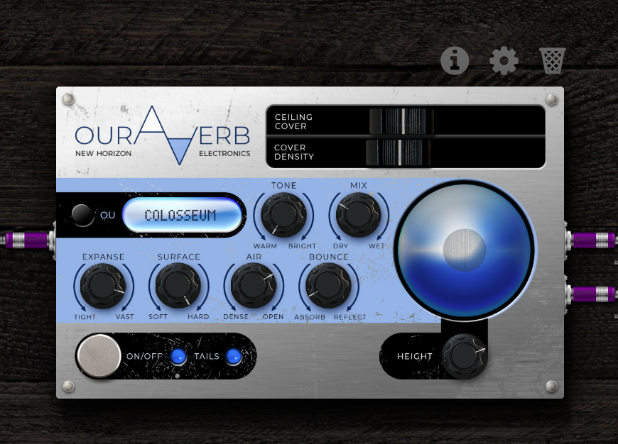

# OurAVerb

*New Horizon Electronics · an outdoor reverb for MOD Duo, Duo X and Dwarf*

## Ouros, gods of the mountains

The OurAVerb is here to get your tone all the way out there! It's an outdoor focussed reverb
designer that is just a bit different from the usual. I've been tweaking this for some time to let
you dial in a variety of amazing tones without a roof (well, as much or little roof as you want).

## That other reverb

I really wanted a reverb that was not a box and would feel more like busking, playing my acoustic
in the forest, playing drums in an old quarry, and yes a "Pompeii" setting for when I need to
recreate Pink Floyd's epic outdoor masterpiece.

## Why it sounds like nothing else

There's no "lid on the can". Everything considers the sky above, with the ability to "cover up" to
varying degrees (think foliage, cloth).

- **Echoes, not a wash.** In a room, sound bounces around until it blurs into one smooth tail.
  Outdoors it flies off and comes back from whatever it hits: a cliff, a far ridge, a line of
  trees. You hear separate answers, each one later and further away than the last.
- **Distance has a sound.** Air eats treble. The far canyon wall answers darker than the rock
  next to you, just like the real thing.
- **What it hits matters.** Rock sends back a sharp copy. Trees scatter it into a soft haze.
  Fresh snow swallows nearly all of it.
- **Hills are picky.** A surface only bounces back pitches smaller than itself. Hillsides return
  the bright, crisp part of your sound, while the low end wraps around them and rolls on like
  distant thunder.
- **Real left and right.** The walls sit either side of you. In a fjord the echo ping-pongs
  across the water and reaches each ear a split second apart, the way your ears place a sound in
  the real world.
- **Sky optional.** Pull a cover over any place: a sail over a fjord, canvas over an
  amphitheatre, ice over a canyon. How high it hangs tunes it, from a slow flutter down to a
  humming drone.

## The controls

### Location: where you are

- **Place** (the **OU** button and display): Fjord, Canyon, Valley, Forest or Colosseum. Each one
  is a different shape, with its own pattern of echoes. Press OU to step through them. The new
  place answers what you just played, so you can switch mid-song.
- **Expanse** (tight → vast): how far away the walls are. Turn it while you play and the echoes
  bend like tape. A fjord turned right down becomes a city street.
- **Surface** (soft → hard): what the walls are made of. Hard is rock: sharp, loud echoes. Soft
  is foliage, and right down at the bottom, fresh snow: quieter, darker, smeared into a haze.

### Distance: what happens on the way

- **Air** (dense → open): dense air eats the top end, and far echoes lose the most. Open air
  keeps everything bright.
- **Bounce** (absorb → reflect): how many times the echo crosses back and forth. All the way to
  absorb, each wall answers once. Towards reflect, it keeps going.
- **Tone** (warm → bright): which pitches the place throws back. Bright is hills, glass and ice:
  thin, crisp echoes with the low end rolling on underneath. Warm is wood and earth: the highs get
  soaked up. Noon is neutral.
- **Height**: where the cover hangs, from 1 to 60 metres. High gives a slow flutter, low gives a
  drone. Sweep it while you play for a flange. You only hear it when there's a cover up.

### Cover: how much sky

- **Ceiling cover**: how much of the sky is closed, from open air to fully covered.
- **Cover density**: what the cover is made of, from canvas (soft, dark, leaky) to ice (bright and
  glassy).

### Mix

- **Mix** (dry → wet): up to halfway your dry signal stays at full level and the echoes come in on
  top. Past halfway the dry fades out.
- **Tails**: when it's lit, the echoes ring out after you switch the pedal off. When it's off,
  they stop with it.
- **On/Off**: the footswitch.

In MOD's settings panel the controls are grouped the same way: Location, Distance, Cover, Mix.

## The orb

The big display shows the space you've built:

- the **cover** grows as you close the sky and turns more solid with Cover density;
- the **ripples** move with your playing;
- the orb **darkens** as the cover hangs higher, most towards the top of the Height knob.

## The places

| Place | What it is |
| --- | --- |
| Fjord | Two sheer rock walls about a kilometre apart, with water underneath. Long echoes bouncing left and right |
| Canyon | Walls a couple of hundred metres away, with ledges and gullies answering in between |
| Valley | Distant rolling slopes: many soft answers spread over several seconds |
| Forest | Tree trunks all around you, close by. A short haze rather than echoes |
| Colosseum | A stepped stone bowl with no roof. The seating rows answer one after another, turning a clap into a falling chirp |

## Presets

Presets set the space, not the balance: loading one leaves your Mix where it is.

| Preset | What it is |
| --- | --- |
| Inner City | A fjord shrunk to a street: building fronts slapping back and forth |
| Box Canyon | Rock walls, long bounce |
| Quarry | The Colosseum scaled up and roughed in: big terraces, rougher chirp |
| Fjord Under Sail | A fjord with a sail stretched over it |
| Rainforest | Tall trees, soft foliage and a leafy canopy overhead |
| Snowfield | Fresh snow: almost nothing comes back |
| Ice Cathedral | An amphitheatre under a low, glassy ice roof |
| Drone Fjord | A sail two metres overhead, humming under the echoes |
| Hill Country | Tree-covered hills: bright answers, the lows rolling on |
| Pompeii Arena | The amphitheatre at Pompeii, bare stone and empty seats |
| Epidaurus | The Greek theatre, whose stone rows ring around an A |
| Königssee | The Bavarian lake where the rock wall answers a trumpet up to seven times |
| Bottom of the Well | Deep, close stone |
| Testing Booth | A tiny box with a low glassy lid that hums under every note |

## Install

1. Connect your MOD by USB.
2. Open [builder.mod.audio](https://builder.mod.audio/buildroot) in Chrome and upload
   `mod-plugin-builder/nhe-ouraverb/nhe-ouraverb.mk` from this repo.
3. When the build finishes, click **Install**. OurAVerb appears under Reverb.

Mono in, stereo out. Most settings sit comfortably on a Duo. The heaviest ones (Forest under a
closed cover with Tone turned up) use about twice what a lush hall reverb does, so keep an eye on
the CPU meter.

### OurAVerb Stereo

For stereo sources (a keyboard, a stereo chorus before it) there's a second plugin, **Ouraverb
Stereo**: upload `mod-plugin-builder/nhe-ouraverb-stereo/nhe-ouraverb-stereo.mk` the same way. It
is two OurAVerbs in one: the left input makes the left side of the space, the right input the
right. Same controls, presets and face. Patch one source into both inputs and it sounds exactly
like the mono one. It uses about 1.6 to 1.8 times the CPU of the mono version (two separate
copies would be twice).

## Credits and licence

Designed by Niels, New Horizon Electronics. Code GPL-3.0-or-later (`LICENSE`). Artwork © 2026 New
Horizon Electronics (`ARTWORK-LICENSE.md`). Built with [DPF](https://github.com/DISTRHO/DPF) and
the [MOD plugin playbook](https://github.com/Kiwooky/MOD-plugin-playbook).

Building it yourself, the tests and how it works inside: [`DEVELOPER-NOTES.md`](DEVELOPER-NOTES.md)
and [`docs/spec.md`](docs/spec.md).
